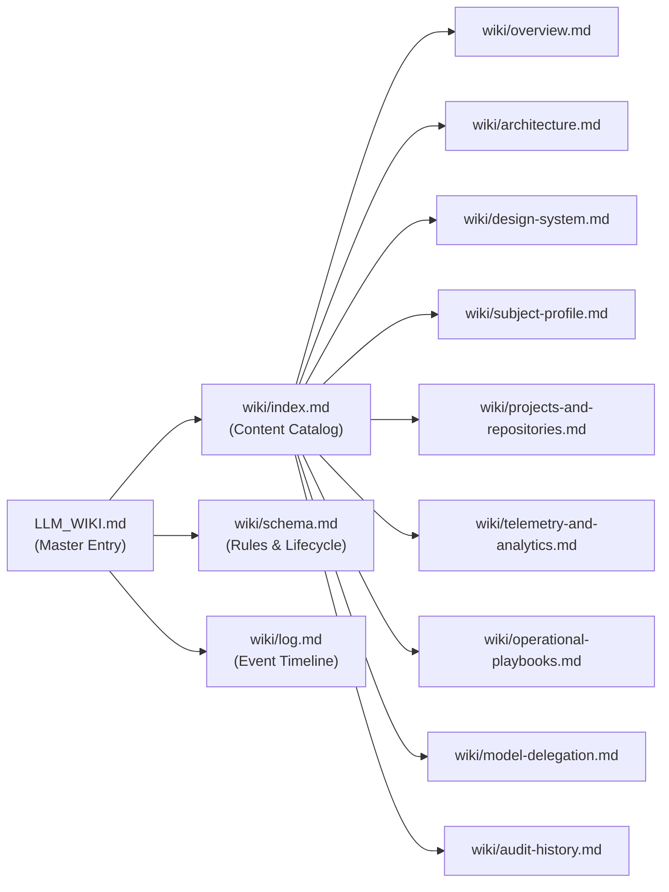

# LLM Wiki: Lenin Meza Enterprise Portfolio (`merolhack.github.io`)

> **Architectural Pattern**: Modular LLM Wiki ([Andrej Karpathy Gist Reference](https://gist.github.com/karpathy/442a6bf555914893e9891c11519de94f))  
> **Status**: Modularized into [`wiki/`](file:///Ubuntu-20.04/home/merolhack/fl/merolhack.github.io/wiki/) directory  
> **Repository**: `merolhack/merolhack.github.io` (`lenin-meza-portfolio`)

---

## 🏛️ Architecture of this Wiki

Per the **Karpathy LLM Wiki pattern**, this knowledge base is divided into three distinct layers:

1. **Raw Sources (Immutable)**: The actual repository code and configuration (`src/`, `package.json`, `next.config.ts`, `.github/workflows/deploy.yml`).
2. **The Schema**: Defined in [`wiki/schema.md`](file:///Ubuntu-20.04/home/merolhack/fl/merolhack.github.io/wiki/schema.md), dictating how agents ingest sources, answer queries, and run lint passes.
3. **The Wiki**: A structured, modular directory of markdown files in [`wiki/`](file:///Ubuntu-20.04/home/merolhack/fl/merolhack.github.io/wiki/) maintained continuously by AI agents.

---

## 🚀 Quick Navigation

AI agents and human developers should use [`wiki/index.md`](file:///Ubuntu-20.04/home/merolhack/fl/merolhack.github.io/wiki/index.md) as the primary index rather than reading the entire codebase:

### 1. Foundations & Engineering Mandates
- **[System Overview](file:///Ubuntu-20.04/home/merolhack/fl/merolhack.github.io/wiki/overview.md)**: Goals, static architecture, and zero-server infrastructure.
- **[Technical Architecture](file:///Ubuntu-20.04/home/merolhack/fl/merolhack.github.io/wiki/architecture.md)**: Next.js static export (`output: 'export'`), React 19, Tailwind CSS v4, and directory layout.
- **[Design System](file:///Ubuntu-20.04/home/merolhack/fl/merolhack.github.io/wiki/design-system.md)**: Deep Dark Mode tokens, glassmorphism, Framer Motion scroll indicators, and Navbar thresholds.

### 2. Subject & Domain Knowledge
- **[Subject Profile: Lenin Meza](file:///Ubuntu-20.04/home/merolhack/fl/merolhack.github.io/wiki/subject-profile.md)**: 17+ years enterprise timeline, BaaS architecture, Incode biometrics, and competencies.
- **[Projects, Book & Repositories](file:///Ubuntu-20.04/home/merolhack/fl/merolhack.github.io/wiki/projects-and-repositories.md)**: Live platforms (DQRO.mx, Freelance México), Amazon KDP Book (314p), and active GitHub repos.

### 3. Operations & Automation
- **[Telemetry & Search Console](file:///Ubuntu-20.04/home/merolhack/fl/merolhack.github.io/wiki/telemetry-and-analytics.md)**: Google Analytics GA4 (`G-8STYZ8GZRJ`), Search Console verification file (`google7d4ec8c5344a17de.html`), JSON-LD schema.
- **[Operational Playbooks & CI/CD](file:///Ubuntu-20.04/home/merolhack/fl/merolhack.github.io/wiki/operational-playbooks.md)**: GitHub Pages deployment pipeline, UI component procedures, and troubleshooting gotchas.
- **[Model Delegation Protocol](file:///Ubuntu-20.04/home/merolhack/fl/merolhack.github.io/wiki/model-delegation.md)**: Secondary model delegation hierarchy (`gemma4:cloud` &rarr; `qwen3:8b-8k` local) and mandatory delegation matrix.
- **[Version History & Audit Log](file:///Ubuntu-20.04/home/merolhack/fl/merolhack.github.io/wiki/audit-history.md)**: Complete chronological release milestones.

---

## 🛠️ Operational Protocol for AI Agents
To ingest new information or query the wiki, always follow the rules defined in [`wiki/schema.md`](file:///Ubuntu-20.04/home/merolhack/fl/merolhack.github.io/wiki/schema.md).
