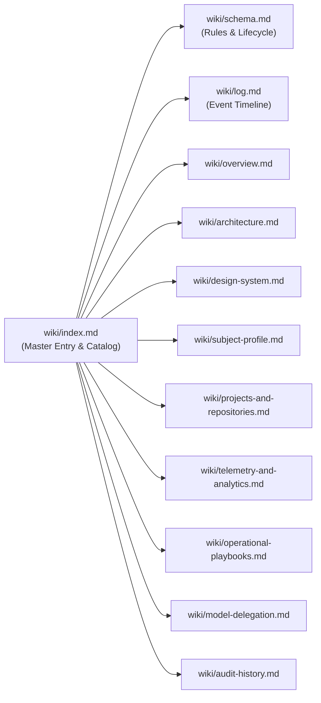

# LLM Wiki Catalog & Master Index

> **Architecture Reference**: [Karpathy LLM Wiki Pattern](https://gist.github.com/karpathy/442a6bf555914893e9891c11519de94f)  
> **Repository**: `merolhack/merolhack.github.io` (`lenin-meza-portfolio`)  
> **Schema & Guidelines**: [`wiki/schema.md`](file:///Ubuntu-20.04/home/merolhack/fl/merolhack.github.io/wiki/schema.md)  
> **Activity Log**: [`wiki/log.md`](file:///Ubuntu-20.04/home/merolhack/fl/merolhack.github.io/wiki/log.md)

---

## 🏛️ Architecture of this Wiki

Per the **Karpathy LLM Wiki pattern**, this knowledge base is modularized in the `wiki/` directory:

1. **Raw Sources (Immutable)**: The actual repository code and configuration (`src/`, `package.json`, `next.config.ts`, `.github/workflows/deploy.yml`, `public/`).
2. **The Schema**: Defined in [`wiki/schema.md`](file:///Ubuntu-20.04/home/merolhack/fl/merolhack.github.io/wiki/schema.md), dictating how agents ingest sources, answer queries, and run lint passes.
3. **The Wiki**: A structured, modular directory of markdown files in [`wiki/`](file:///Ubuntu-20.04/home/merolhack/fl/merolhack.github.io/wiki/) maintained continuously by AI agents.

---

## ⚡ MANDATORY OPERATIONAL RULES FOR ALL AGENTS [REQUIRED]

All autonomous agents (including Google Antigravity) interacting with this repository **MUST** adhere to these 4 core mandates on every prompt and task:

1. **FIRST USE LLM WIKI & UPDATE MODULARLY AT THE END [MANDATORY]**:
   - **Knowledge First**: Before inspecting or modifying code, always consult the **LLM Wiki** ([`wiki/index.md`](file:///Ubuntu-20.04/home/merolhack/fl/merolhack.github.io/wiki/index.md)) to understand the system architecture, domain data, and operational constraints without re-reading the entire codebase.
   - **Modular End-of-Task Sync**: At the conclusion of **every** coding or configuration task, the agent **MUST** update the LLM Wiki in a modular fashion: update the relevant topic page in `wiki/`, refresh [`wiki/index.md`](file:///Ubuntu-20.04/home/merolhack/fl/merolhack.github.io/wiki/index.md) if new concepts arose, and append an entry to [`wiki/log.md`](file:///Ubuntu-20.04/home/merolhack/fl/merolhack.github.io/wiki/log.md).

2. **CODEBASE MEMORY KNOWLEDGE GRAPH [MANDATORY]**:
   - **Target Project**: `home-merolhack-fl-merolhack.github.io` (`/home/merolhack/fl/merolhack.github.io`).
   - **Tool Priority**: ALWAYS query `codebase-memory` MCP tools (`search_graph`, `query_graph`, `trace_path`, `get_code_snippet`, `detect_changes`) for code discovery, symbols, callers, and route references BEFORE falling back to broad text search or grep.
   - **Sync**: Verify index freshness with `index_status(project="home-merolhack-fl-merolhack.github.io")` and run `detect_changes` after modifications.

3. **OLLAMA-LOCAL MODELS TO SAVE TOKENS [MANDATORY]**:
   - Whenever a task is mechanical, repetitive, or low-risk (docstrings, boilerplate, repetitive markup, JSON formatting, simple regex, single-file translations), agents **MUST** delegate execution via the `consultar_modelo_local` tool (`ollama-local` server).
   - **Model Cascade**: Priority 1 `gemma4:cloud` (when weekly quota < 90%), falling back automatically to local `qwen3:8b-8k`.
   - Never waste primary agent tokens on routine formatting or boilerplate.

4. **MANDATORY COMMIT, PUSH & GITHUB ACTIONS VALIDATION [MANDATORY]**:
   - **Local Validation First**: Antes de concluir cualquier actividad, el agente **DEBE** validar localmente con `npm run lint` y `npm run build` (garantizando 0 errores y exportación estática Next.js limpia).
   - **Commit y Push al Repositorio Remoto**: Con la validación local aprobada, el agente **DEBE** ejecutar `git add`, crear un commit bajo el estándar Conventional Commits (`feat:`, `fix:`, `docs:`, etc.) y hacer `git push origin main`.
   - **Validación del Estado de GitHub Actions**: Posterior al push, el agente **DEBE** verificar el pipeline de GitHub Actions (`gh run list --limit 1` o `gh run watch`) asegurando estado `completed` y conclusión `success`.

---

## 📚 Categorized Knowledge Pages

### 1. System Foundations & Architecture
| Page | Summary | Key Topics |
| :--- | :--- | :--- |
| [`overview.md`](file:///Ubuntu-20.04/home/merolhack/fl/merolhack.github.io/wiki/overview.md) | High-level system purpose, decoupling strategy, and zero-server infrastructure. | Portfolio Goals, Static Architecture, Single Source of Truth |
| [`architecture.md`](file:///Ubuntu-20.04/home/merolhack/fl/merolhack.github.io/wiki/architecture.md) | Technical constraints, Next.js static export mandates, and dependency tree. | `output: 'export'`, React 19, Tailwind v4, Directory Layout |
| [`design-system.md`](file:///Ubuntu-20.04/home/merolhack/fl/merolhack.github.io/wiki/design-system.md) | Vibe Coding standards, Deep Dark Mode, glassmorphism, and Framer Motion. | Design Tokens, Scroll Fades, Hero Indicator, Navbar Thresholds |

### 2. Subject & Domain Model
| Page | Summary | Key Topics |
| :--- | :--- | :--- |
| [`subject-profile.md`](file:///Ubuntu-20.04/home/merolhack/fl/merolhack.github.io/wiki/subject-profile.md) | Biographical profile, 17+ years enterprise career timeline, and skills matrix. | Lenin Meza, BaaS, Incode Biometrics, VoIP GCP, Togaf/Bian |
| [`projects-and-repositories.md`](file:///Ubuntu-20.04/home/merolhack/fl/merolhack.github.io/wiki/projects-and-repositories.md) | Production platforms (Cadensa, DQRO.mx, Freelance México), KDP book, and git repos. | Personal Platforms, MACH Playbook (314p), PressVitals, OMniLeads |

### 3. Operations, Telemetry & AI Workflows
| Page | Summary | Key Topics |
| :--- | :--- | :--- |
| [`telemetry-and-analytics.md`](file:///Ubuntu-20.04/home/merolhack/fl/merolhack.github.io/wiki/telemetry-and-analytics.md) | GA4 tracking stream, Google Search Console HTML verification, and JSON-LD. | GA4 `G-8STYZ8GZRJ`, Search Console Token, Schema.org Person |
| [`operational-playbooks.md`](file:///Ubuntu-20.04/home/merolhack/fl/merolhack.github.io/wiki/operational-playbooks.md) | CI/CD GitHub Pages deployment, UI component creation, and gotchas. | `.github/workflows/deploy.yml`, Actions Overrides, Hydration |
| [`model-delegation.md`](file:///Ubuntu-20.04/home/merolhack/fl/merolhack.github.io/wiki/model-delegation.md) | Secondary model delegation protocol for Ollama (`gemma4:cloud` / `qwen3:8b-8k`). | Multi-Tier Cascade, Quota Check, `consultar_modelo_local` |
| [`audit-history.md`](file:///Ubuntu-20.04/home/merolhack/fl/merolhack.github.io/wiki/audit-history.md) | Complete version changelog and architectural decision milestone records. | Releases v1.0.0 through v1.0.7 |

---

## 📁 Source Documents (Raw Layer)

| Source File | Description | Mapped Wiki Target |
| :--- | :--- | :--- |
| [`src/data/subject.ts`](file:///Ubuntu-20.04/home/merolhack/fl/merolhack.github.io/src/data/subject.ts) | Master biographical data & repo lists | [`subject-profile.md`](file:///Ubuntu-20.04/home/merolhack/fl/merolhack.github.io/wiki/subject-profile.md) & [`projects-and-repositories.md`](file:///Ubuntu-20.04/home/merolhack/fl/merolhack.github.io/wiki/projects-and-repositories.md) |
| [`next.config.ts`](file:///Ubuntu-20.04/home/merolhack/fl/merolhack.github.io/next.config.ts) | Static export and unoptimized images | [`architecture.md`](file:///Ubuntu-20.04/home/merolhack/fl/merolhack.github.io/wiki/architecture.md) |
| [`package.json`](file:///Ubuntu-20.04/home/merolhack/fl/merolhack.github.io/package.json) | NPM dependencies & runtime versions | [`architecture.md`](file:///Ubuntu-20.04/home/merolhack/fl/merolhack.github.io/wiki/architecture.md) |
| [`.github/workflows/deploy.yml`](file:///Ubuntu-20.04/home/merolhack/fl/merolhack.github.io/.github/workflows/deploy.yml) | GitHub Actions CI/CD deployment workflow | [`operational-playbooks.md`](file:///Ubuntu-20.04/home/merolhack/fl/merolhack.github.io/wiki/operational-playbooks.md) |
| [`public/google7d4ec8c5344a17de.html`](file:///Ubuntu-20.04/home/merolhack/fl/merolhack.github.io/public/google7d4ec8c5344a17de.html) | Search Console verification token | [`telemetry-and-analytics.md`](file:///Ubuntu-20.04/home/merolhack/fl/merolhack.github.io/wiki/telemetry-and-analytics.md) |
| [`AGENTS.md`](file:///Ubuntu-20.04/home/merolhack/fl/merolhack.github.io/AGENTS.md) | Agent operational rules & model delegation | [`schema.md`](file:///Ubuntu-20.04/home/merolhack/fl/merolhack.github.io/wiki/schema.md) & [`model-delegation.md`](file:///Ubuntu-20.04/home/merolhack/fl/merolhack.github.io/wiki/model-delegation.md) |
