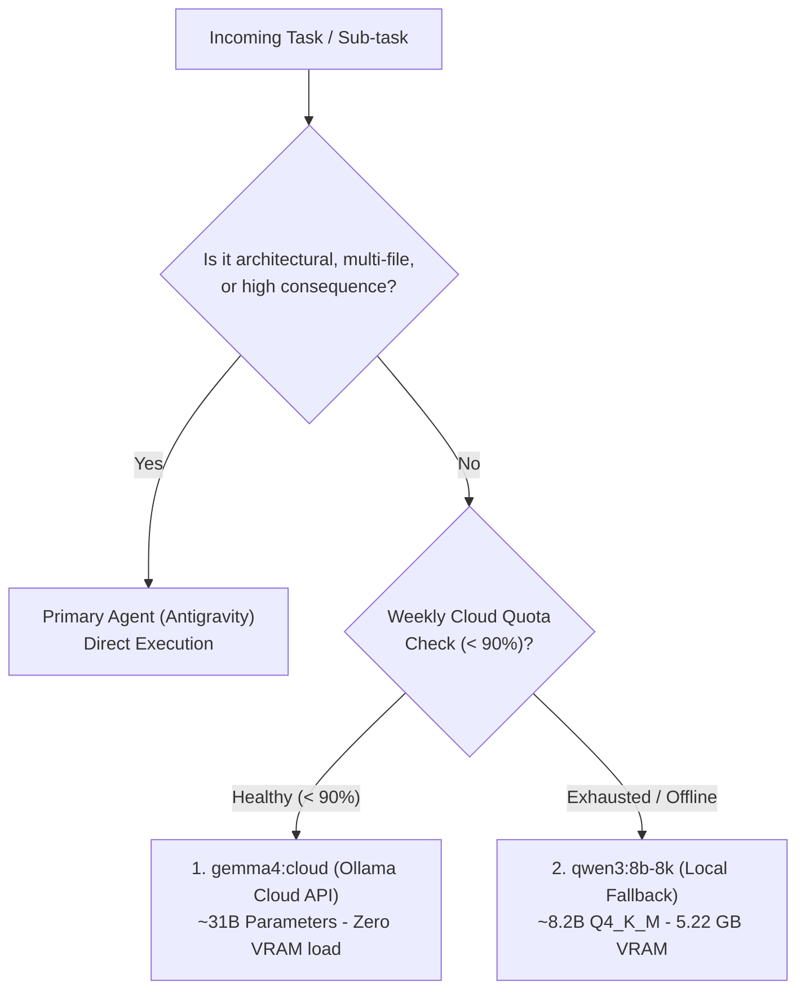

# Secondary Model Delegation Protocol (Ollama)

> **Index**: [Catalog](file:///Ubuntu-20.04/home/merolhack/fl/merolhack.github.io/wiki/index.md) | **Schema**: [Schema & Operations](file:///Ubuntu-20.04/home/merolhack/fl/merolhack.github.io/wiki/schema.md)

---

## 1. Overview & Architectural Motivation

To conserve primary agent cognitive tokens and prevent rate limit exhaustion during routine coding sessions, agents operating on this repository **MUST** delegate mechanical, repetitive, and low-risk tasks to secondary models via the `ollama-local` MCP server.

---

## 2. Multi-Tier Model Hierarchy

### Priority 1: `gemma4:cloud`
- **Developer**: Google DeepMind
- **Environment**: Ollama Cloud API (`gemma4:cloud`)
- **Scale**: ~31 Billion parameters
- **Quota Gate**: Automatically monitored via the Ollama weekly usage endpoint. If usage is `< 90%`, requests are routed to this model.
- **Advantages**: Superior structured reasoning, clean markdown formatting, zero GPU/VRAM load on the local machine.

### Priority 2 (Local Fallback): `qwen3:8b-8k`
- **Developer**: Alibaba Cloud (Qwen Team)
- **Local Tag**: `qwen3:8b-8k` (base `qwen3:8b`)
- **Quantization**: `Q4_K_M` in GGUF format (~5.22 GB footprint)
- **Context Window**: 8,192 tokens active inference window (natively up to 40,960 tokens)
- **MCP Bridge Script**: `C:\Users\lenin\Documents\AIDevelopment\ollama\ollama_mcp_server.py`
- **MCP Tool**: `consultar_modelo_local` on server `ollama-local`
- **Endpoint**: `http://localhost:11434/v1/chat/completions`

---

## 3. Mandatory Delegation Matrix

| Category | Delegation Rule | Tool / Engine |
| :--- | :---: | :--- |
| **Docstrings, comments & type annotations** | **MUST DELEGATE** | `ollama-local` &rarr; `consultar_modelo_local` |
| **Boilerplate & repetitive structures** | **MUST DELEGATE** | `ollama-local` &rarr; `consultar_modelo_local` |
| **Markdown cleanup, regex & basic parsing** | **MUST DELEGATE** | `ollama-local` &rarr; `consultar_modelo_local` |
| **Isolated mechanical translations & summaries** | **MUST DELEGATE** | `ollama-local` &rarr; `consultar_modelo_local` |
| **Isolated single-file question answering** | **MUST DELEGATE** | `ollama-local` &rarr; `consultar_modelo_local` |
| **Architectural design & system decisions** | **DO NOT DELEGATE** | Primary Agent (Antigravity) |
| **Refactoring spanning multiple files** | **DO NOT DELEGATE** | Primary Agent (Antigravity) |
| **Git operations, CI/CD & live deployments** | **DO NOT DELEGATE** | Primary Agent (Antigravity) |
| **Security audits & credential handling** | **DO NOT DELEGATE** | Primary Agent (Antigravity) |
