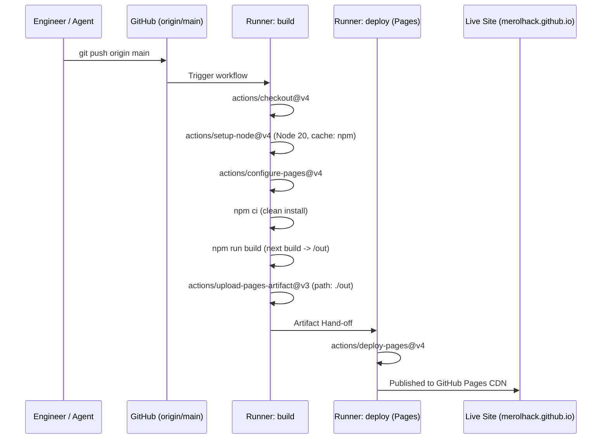

# Operational Playbooks, CI/CD & Troubleshooting

> **Index**: [Catalog](file:///Ubuntu-20.04/home/merolhack/fl/merolhack.github.io/wiki/index.md) | **Architecture**: [Technical Architecture](file:///Ubuntu-20.04/home/merolhack/fl/merolhack.github.io/wiki/architecture.md)

---

## 1. CI/CD Deployment Pipeline (`.github/workflows/deploy.yml`)

The repository deploys autonomously to GitHub Pages upon pushing to the `main` branch.



### Critical Action Hook Rule
> [!WARNING]
> **Do not inject `static_site_generator: next`** into `actions/configure-pages`.  
> Doing so forces GitHub's default Next.js action overrides, which rewrite local `next.config.ts` static export directives and result in `404 Not Found` asset loading errors. The configuration must remain unopinionated so that local `npm run build` dictates the `/out` directory.

---

## 2. UI & Component Development Protocol

When developing or modifying UI components:
1. **Adding Shadcn Primitives**:
   ```bash
   npx shadcn@latest add [component-name]
   ```
2. **Component File Placement**:
   - Page sections: `src/components/sections/`
   - Reusable atom/molecule primitives: `src/components/ui/`
3. **Data Binding**:
   - Always read profile, metrics, links, and content from [`src/data/subject.ts`](file:///Ubuntu-20.04/home/merolhack/fl/merolhack.github.io/src/data/subject.ts).
4. **Local Build & Test Verification**:
   ```bash
   # Typecheck and static export verification
   npm run build

   # Code linting
   npm run lint

   # Local server execution
   npm run dev
   ```

---

## 3. Troubleshooting & Gotchas

### Issue 1: Hydration Mismatch with Browser APIs
- **Symptom**: `ReferenceError: window is not defined` or hydration mismatch warnings.
- **Cause**: Using browser APIs (`window`, `document`, `navigator`, `localStorage`) inside components rendered during server prerendering.
- **Solution**: Mark components with `"use client"` and either access APIs inside `useEffect()`, or dynamically import with `ssr: false`:
  ```typescript
  import dynamic from 'next/dynamic';

  const DynamicWidget = dynamic(
    () => import('@/components/Widget'),
    { ssr: false }
  );
  ```

### Issue 2: Image Optimization Failure
- **Symptom**: Export fails or images render broken with `/_next/image?url=...` 404s.
- **Cause**: `images: { unoptimized: true }` missing from `next.config.ts`.
- **Solution**: Verify `unoptimized: true` is set in `next.config.ts`.

### Issue 3: Windows NTFS Zone Identifiers
- **Symptom**: Files downloaded through Windows onto WSL filesystem create companion `:Zone.Identifier` stream files.
- **Solution**: Remove the stream file before `git add`:
  ```bash
  rm -f 'public/filename:Zone.Identifier'
  ```
