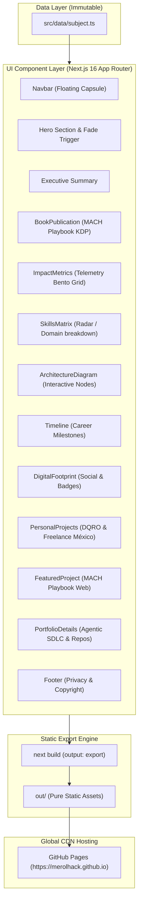

# System Overview & High-Level Purpose

> **Index**: [Catalog](file:///Ubuntu-20.04/home/merolhack/fl/merolhack.github.io/wiki/index.md) | **Schema**: [Schema & Operations](file:///Ubuntu-20.04/home/merolhack/fl/merolhack.github.io/wiki/schema.md)

---

## 1. Executive Summary

The `lenin-meza-portfolio` repository (`merolhack.github.io`) is a high-performance, statically exported web application serving as the official enterprise portfolio and digital footprint for **Lenin Meza** (Senior Software Architect & Technical Lead).

The portfolio is deployed to **GitHub Pages** with zero runtime server costs, sub-second global CDN delivery, and full compliance with static site export constraints.

---

## 2. Core Architectural Pillars

### A. Purity of Information
Biographical data, project metadata, metrics, and experience timelines are strictly isolated within an immutable master data layer:
- Master file: [`src/data/subject.ts`](file:///Ubuntu-20.04/home/merolhack/fl/merolhack.github.io/src/data/subject.ts).
- UI components consume data exclusively from this bridge, avoiding hallucination and duplicated state.

### B. Zero-Server Infrastructure
- The site compiles 100% to static HTML, CSS, JavaScript, and unoptimized asset files.
- Export directory: `/out`.
- No dynamic Node.js server dependencies, eliminating server runtime attack vectors and infrastructure management.

### C. Vibe Coding & Enterprise Aesthetics
- Presenting a "Deep Dark Mode" enterprise aesthetic (`zinc-950` / glassmorphism) tailored for a Senior Architect profile with 17+ years of experience across BaaS, biometric identity verification, and VoIP cloud telecommunications.

### D. Compounding Knowledge (LLM Wiki Pattern)
- Built and maintained according to the **Karpathy LLM Wiki** architectural model. Knowledge is continually synthesized into the `wiki/` directory.

---

## 3. High-Level System Architecture

