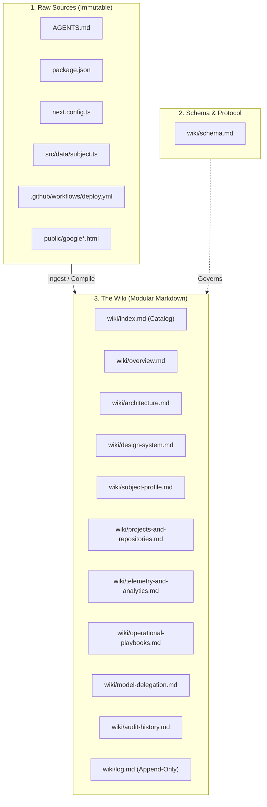
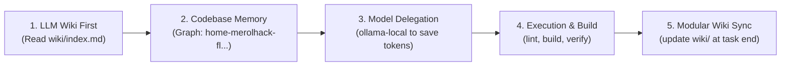

# LLM Wiki Schema & Operational Protocol

> **Reference**: [Karpathy LLM Wiki Architecture](https://gist.github.com/karpathy/442a6bf555914893e9891c11519de94f)  
> **Scope**: `merolhack/merolhack.github.io` (`lenin-meza-portfolio`)  
> **Maintainers**: Google Antigravity & Lenin Meza

---

## 1. Architectural Philosophy

The LLM Wiki is a persistent, modular, compounding knowledge base that sits between human developers/AI agents and the raw repository files. Unlike standard ephemeral RAG (which re-derives answers from scratch on every prompt), this wiki is compiled once and continuously maintained, cross-referenced, and kept in sync with the codebase.



---

## 2. Mandatory Agent Workflow Cycle [REQUIRED]

Every autonomous agent working on this repository MUST execute the following 5-phase cycle on every task:



1. **Step 1 — LLM Wiki First**: Before reading files or guessing architecture, consult [`wiki/index.md`](file:///Ubuntu-20.04/home/merolhack/fl/merolhack.github.io/wiki/index.md) and the targeted wiki pages.
2. **Step 2 — Codebase Memory Graph**: ALWAYS prioritize `codebase-memory` MCP tools targeting project `home-merolhack-fl-merolhack.github.io` (`/home/merolhack/fl/merolhack.github.io`) for function, route, class, and caller discovery before using ripgrep or reading raw files.
3. **Step 3 — Ollama-Local Delegation**: For mechanical, repetitive, and low-risk tasks (boilerplate, docstrings, formatting, basic regex), ALWAYS delegate to secondary models via `consultar_modelo_local` (`gemma4:cloud` &rarr; `qwen3:8b-8k`) to conserve primary tokens.
4. **Step 4 — Implementation & Build Validation**: Execute code edits and validate locally with `npm run lint` and `npm run build` (`output: 'export'`).
5. **Step 5 — Modular End-of-Task Update**: Conclude every task by updating the affected modular wiki pages, updating [`wiki/index.md`](file:///Ubuntu-20.04/home/merolhack/fl/merolhack.github.io/wiki/index.md), and appending an entry to [`wiki/log.md`](file:///Ubuntu-20.04/home/merolhack/fl/merolhack.github.io/wiki/log.md).

---

## 3. The Three Layers

1. **Raw Sources (Immutable)**: The actual code, configuration, assets, and documentation files in the repository. The LLM reads from them but treats them as the ground truth.
2. **The Wiki (`wiki/`)**: Modular, interlinked Markdown files synthesizing the architecture, decisions, domain model, and operational procedures.
3. **The Schema (`wiki/schema.md`)**: This document, dictating formatting, conventions, and operational lifecycle for both AI agents and human engineers.

---

## 4. Operational Protocols

### A. Ingestion Protocol (`ingest`)
When a new feature, source file, library, or architectural rule is added:
1. **Read & Extract**: Inspect the new or modified raw source files.
2. **Modular Update**: Identify which modular wiki pages are affected. Update existing pages or create a new dedicated page if introducing a distinct domain.
3. **Cross-Reference**: Ensure bidirectional or associative links between pages.
4. **Catalog Sync**: Update [`wiki/index.md`](file:///Ubuntu-20.04/home/merolhack/fl/merolhack.github.io/wiki/index.md) with any new page titles, descriptions, and category placement.
5. **Log Entry**: Append an entry to [`wiki/log.md`](file:///Ubuntu-20.04/home/merolhack/fl/merolhack.github.io/wiki/log.md) using the canonical format:
   ```markdown
   ## [YYYY-MM-DD] ingest | Title of change
   - **Sources**: list of files touched
   - **Summary**: bulleted summary of key takeaways
   - **Wiki Pages Updated**: [page link](file:///...)
   ```

### B. Query Protocol (`query`)
When an AI agent or human needs context on the system:
1. **Index First**: Read [`wiki/index.md`](file:///Ubuntu-20.04/home/merolhack/fl/merolhack.github.io/wiki/index.md) to locate the exact topic page rather than reading the entire codebase.
2. **Targeted Read**: Read only the relevant modular wiki pages.
3. **Compound Findings**: If a deep query reveals a novel architectural synthesis or solves a complex issue, file that insight back into the wiki as a new section or page.

### C. Health Check & Lint Protocol (`lint`)
Periodically verify the integrity of the wiki:
- **Consistency**: Ensure dependency versions in [`wiki/architecture.md`](file:///Ubuntu-20.04/home/merolhack/fl/merolhack.github.io/wiki/architecture.md) match [`package.json`](file:///Ubuntu-20.04/home/merolhack/fl/merolhack.github.io/package.json).
- **Broken Links**: Verify that all relative links and file links resolve correctly.
- **Orphan Check**: Ensure every modular page is linked from [`wiki/index.md`](file:///Ubuntu-20.04/home/merolhack/fl/merolhack.github.io/wiki/index.md).
- **Log Formatting**: Confirm all entries in [`wiki/log.md`](file:///Ubuntu-20.04/home/merolhack/fl/merolhack.github.io/wiki/log.md) match the `## [YYYY-MM-DD] action | title` grep-friendly pattern.

---

## 4. Page Conventions & Standards
- **File Names**: Lowercase kebab-case (e.g. `subject-profile.md`, `model-delegation.md`).
- **Headers**: Start each file with a clear `# Title`, a short quote/callout block defining its purpose, and links back to the index.
- **Clickable File Links**: Adhere to markdown links with `file:///` URLs or clean relative paths.
- **Language**: Technical documentation in English and Spanish where domain-appropriate.
