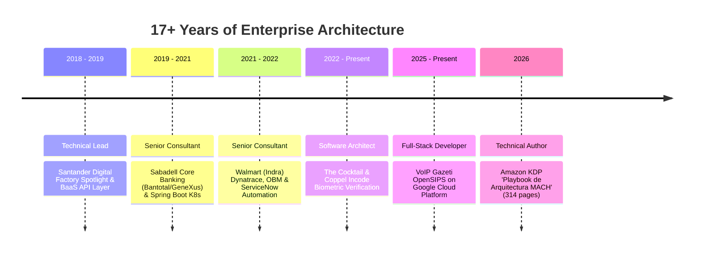

# Subject & Enterprise Domain Model: Lenin Meza

> **Index**: [Catalog](file:///Ubuntu-20.04/home/merolhack/fl/merolhack.github.io/wiki/index.md) | **Source Bridge**: [`src/data/subject.ts`](file:///Ubuntu-20.04/home/merolhack/fl/merolhack.github.io/src/data/subject.ts)

---

## 1. Professional Profile

- **Name**: Lenin Meza
- **Titles**: Senior Software Architect | Technical Author | Technical Lead
- **Location**: El Marqués, Querétaro, Mexico
- **Contact**: `merolhack@gmail.com`
- **Social & Networks**:
  - LinkedIn: [`linkedin.com/in/leninmezazarco`](http://www.linkedin.com/in/leninmezazarco)
  - GitHub: [`github.com/merolhack`](https://github.com/merolhack)
  - StackOverflow: [`stackoverflow.com/users/1006079/lenin-meza`](https://stackoverflow.com/users/1006079/lenin-meza)
  - Dev.to: [`dev.to/merolhack`](https://dev.to/merolhack)
  - Credly: [`credly.com/users/lenin-jose-meza-zarco/badges`](https://www.credly.com/users/lenin-jose-meza-zarco/badges)

---

## 2. Career Progression & Key Roles

### Detailed Career Milestones
1. **Full-Stack Developer VoIP / Gazeti** (*Sep 2025 – Present*):
   - Scalable VoIP telephony infrastructure deployed on Google Cloud Platform (GCP).
   - OpenSIPS Session Border Controllers (SBC) and Yeti-switch trunk routing automation.
2. **Software Architect / The Cocktail** (*Sep 2022 – Present*):
   - Incode Identity Verification integration with biometric face matching and ID document verification.
   - Omnichannel customer onboarding architecture for Coppel following BIAN & TOGAF enterprise standards.
3. **Senior Consultant / Walmart (Indra)** (*Sep 2021 – Sep 2022*):
   - Observability architecture integrating Dynatrace and Microfocus OBM.
   - ServiceNow incident workflow automation using custom Groovy micro-services.
4. **Senior Consultant / Sabadell (Indra)** (*Nov 2019 – Sep 2021*):
   - Bank-as-a-Service (BaaS) microservices integration layer connecting core banking (Bantotal, GeneXus) via Java 21 / Spring Boot on Kubernetes clusters.
5. **Technical Lead / Santander** (*Jan 2018 – Jun 2019*):
   - Digital Factory BaaS microservices and high-throughput Angular single-page applications.

---

## 3. Core Technical Competencies

### Frontend
`React` • `TypeScript` • `Angular (2+, 4, 7)` • `Tailwind CSS v4` • `Bootstrap 4+` • `HTML5 / CSS3` • `ECMAScript` • `Framer Motion`

### Backend & Microservices
`Java (1.8, 17, 21)` • `Spring Boot (1.5, 2, 3)` • `Node.js (Express)` • `PHP 8.3 (Laravel)` • `Serverless Framework` • `RESTful APIs / OpenAPI 3.1`

### Data Persistence & Caching
`PostgreSQL` • `MySQL / MariaDB` • `MongoDB` • `SQL Server` • `Redis` • `Memcached` • `Oracle PL/SQL`

### Cloud, DevOps & Telecom
`Google Cloud Platform (GCP)` • `AWS (EC2, S3, EMR)` • `Docker` • `Kubernetes` • `GitLab CI/CD` • `GitHub Actions` • `OpenSIPS` • `Yeti-switch` • `Dynatrace` • `Ansible` • `Bash Scripting`
